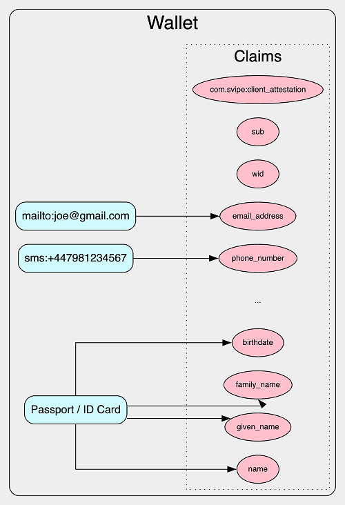

# iProov Identity SDK v0.6.0

The iProov Identity SDK enables you to create an iProov Identity wallet within your Android, iOS or Kotlin Multiplatform
app.

> [!WARNING]
> The iProov Identity SDK is currently a development preview, which means that there may be missing/broken
> functionality, and the API is still subject to change.
> No apps containing this SDK should be put into production without prior approval from iProov.
> We would welcome [your feedback](mailto:support@iproov.com) regarding the iProov Identity SDK preview.

## Requirements

- iOS: 16.0+
- Android: API Level 26+ (DC API requires Android 14+)
- Kotlin Multiplatform: 2.2.0+
- Xcode: 26+ (required for building iOS targets)
- iProov Biometrics SDK, which the Identity SDK depends on but doesn't embed: Android 11.1.x (11.1.1 is resolved
  transitively), iOS 13.x from 13.1.0 (SwiftPM and CocoaPods both allow >= 13.1.0, < 14). Stay on these major versions.

## Concepts and terminology

> [!IMPORTANT]
> Legacy credentials are deprecated and will be removed in a future release.

Before getting started with the iProov Identity SDK, it's worth familiarizing yourself with the following terminology
which describes the core functionality of the SDK:

- **Wallet** - the wallet is the core of the iProov Identity SDK. It holds all of your credentials and any claims
  associated with those credentials. You will only have one wallet for your entire app.

- **Credential** - a credential is an encapsulation of information issued, by an OID4VCI 1.0 compliant issuer, in a
  specific format. Supported formats are `mso_mdoc` and `vc+sd-jwt`.

- **LegacyCredential** - a legacy credential is a piece of information about a user. LegacyCurrently supported
  credentials are documents (specifically, NFC-enabled passports and ID cards following the ICAO 9303 standard), email
  addresses and phone numbers.

- **Claim** - a claim is an attribute that may be associated with a legacy credential (for example, a document will have
  claims `family_name` or `birthdate`, an email will have `email`, etc...). It is provided as
  a [Verifiable Credential](https://www.w3.org/TR/vc-data-model/) (VC). Each claim is provided as its own VC.
  Additionally, there are three special claims (`wid`, `sub` and `com.svipe:client_attestation`) that belong to the
  wallet itself and are not associated with any specific credential.

You can think of the relationships between the wallet, credentials and claims as follows:



## App registration

Before you're able to use the iProov Identity SDK, you must register your app with iProov. Currently, this is performed
as a manual process.

Please contact [support@iproov.com](mailto:support@iproov.com) with the following information:

- For iOS apps:
    - Your bundle (app) ID.
- For Android apps:
    - Your Android application ID.
    - The fingerprint of your Android
      app [signing key certificate](https://play.google.com/console/developers/app/keymanagement). (For further details,
      see [here](https://support.google.com/googleplay/android-developer/answer/9842756?hl=en-GB#:~:text=signing%20to%20continue.-,Step%203,-%3A%20Register%20your%20app)).

## Installation

1. The first step is to install the SDK according to your platform:

    <details>
    <summary>iOS (Swift Package Manager)</summary>

    1. In Xcode, go to File → Add Package Dependencies.

    2. Enter the repository URL for the iProov Identity SDK.

    3. Select your desired version rule (e.g. Up to Next Major Version from `0.6.0`).

    4. Add the `identity` library product to your app target.

   The SDK's transitive dependencies ([iProov](https://github.com/iProov/ios)
   and [JOSESwift](https://github.com/airsidemobile/JOSESwift)) are resolved automatically by SPM.

    </details>

    <details>
    <summary>Android</summary>

   Add the following to your project's `settings.gradle.kts` file:

    ```kotlin
    dependencyResolutionManagement {
      repositories {
          mavenCentral()
          maven("https://raw.githubusercontent.com/iProov/android/master/maven/")
          maven("https://raw.githubusercontent.com/iProov/kotlin-multiplatform/master/maven/")
          maven("https://raw.githubusercontent.com/iProov/identity/master/maven/")
      }
    }
    ```

   Add the following to your module's `build.gradle.kts` file:

    ```kotlin
    dependencies {
      implementation("com.iproov.identity:identity-android:0.6.0")
      implementation("com.iproov.sdk:iproov:11.1.1")
    }
    ```

   Make sure you refer to the docs [here](https://github.com/iProov/android) for the latest instructions to add the
   iProov Biometrics SDK to your app.

    </details>

    <details>
    <summary>Kotlin Multiplatform</summary>

   ### Kotlin Multiplatform

   Add the following to your project's `settings.gradle.kts` file:

    ```kotlin
    dependencyResolutionManagement {
      repositories {
          google()
          mavenCentral()
          maven("https://raw.githubusercontent.com/iProov/android/master/maven/")
          maven("https://raw.githubusercontent.com/iProov/identity/master/maven/")
      }
    }
    ```

   Add the following to your module's `build.gradle.kts` file:

    ```kotlin
    kotlin {
      sourceSets {
          val commonMain by getting {
              dependencies {
                  implementation("com.iproov.identity:identity:0.6.0")
              }
          }
      }
    }
    ```

    </details>

2. You then need to configure your app:

    <details>
    <summary>iOS</summary>

   Camera access permission is required to use the iProov Biometrics SDK to scan the user's face.

   Add an `NSCameraUsageDescription` entry to your app's Info.plist file, with the reason why your app requires camera
   access (e.g. “To iProov you to verify your identity.”)
    </details>

    <details>
    <summary>Android</summary>

   On Android, the default storage engine keeps its data in a file encrypted with a key stored in secure hardware, so
   it can't be read on a different device or after a device reset. The SDK keeps that file in the app's
   `noBackupFilesDir`, which Android never backs up or transfers to another device, so no configuration is needed.

   If you use `EncryptedPreferencesAndroidStorageEngine` instead, its data is in the `com.iproov.identity.xml`
   encrypted shared preferences file, which Android would try to restore from a backup and fail to decrypt. Follow
   these steps to exclude it from your app backups:

    1. Add the following attributes to your `AndroidManifest.xml` file `<application>` tag:

        ```xml
        <application
            ...
            android:fullBackupContent="@xml/backup_rules"
            android:dataExtractionRules="@xml/data_extraction_rules">
        ```

   You could also consider adding `android:allowBackup="false"`, however this will prevent **all** data from your app
   being backed up. It isn't a replacement for these rules: on some manufacturers' devices it doesn't stop
   device-to-device transfer for apps targeting Android 12 and above.

    2. Add the following contents to `res/xml/backup_rules.xml` (for Android 11 and below):

        ```xml
        <full-backup-content>
            <exclude domain="sharedpref" path="com.iproov.identity.xml" />
        </full-backup-content>
        ```

    3. Add the following contents to `res/xml/data_extraction_rules.xml` (for Android 12 and above):

        ```xml
        <data-extraction-rules>
            <cloud-backup>
                <exclude domain="sharedpref" path="com.iproov.identity.xml"/>
            </cloud-backup>
            <device-transfer>
                <exclude domain="sharedpref" path="com.iproov.identity.xml"/>
            </device-transfer>
        </data-extraction-rules>
        ```

    </details>

3. Finally, you can now import the SDK to use it from your project:

    <details>
    <summary>Kotlin</summary>

    ```kotlin
    import com.iproov.identity.*
    ```

    </details>

    <details>
    <summary>Swift</summary>

    ```swift
    import identity
    ```

    </details>

## The wallet

The wallet is the main entry point of the SDK. It is a singleton (you can only have one instance of the wallet for your
app).

You can get a reference to the wallet as follows (in this case, pointing to the dev environment):

<details>
<summary>Kotlin</summary>

```kotlin
val wallet = WalletFactory.getInstance(baseUrl = "https://api.beta-eu.iproov.id")
```

</details>

<details>
<summary>Swift</summary>

```swift
let wallet = try WalletFactory.shared.getInstance(
    baseUrl: "https://api.beta-eu.iproov.id",
    appGroupIdentifier: "group.com.example.wallet",
    isLoggingEnabled: true
)
```

> [!NOTE]
> On iOS the wallet's storage is always configured with an App Group identifier, the container the credential file lives in once the app is entitled to it.
> No entitlement is required until DC-API is needed: until then the wallet stays in the app sandbox.
> Use a group dedicated to your app and its extensions. See
> [Upgrading iOS storage to 0.6.0](docs/features/migration-guide-0.6.0.md).

</details>

If the wallet hasn't yet been initialized on your device, it will be created for you.

> [!NOTE]
> Apps which are compiled for debug/development cannot be used in the production environment. You should use the
> development environment until you are ready to publish your app to any track on Google Play or the App
> Store/TestFlight,
> at which stage you can point to the production environment.

> [!IMPORTANT]
> This will create a wallet locally (if it doesn't exist already), but it doesn't actually register the wallet with
> iProov's backend. Before using it for the first time, you must call `register()` below.

### Trusting credential issuers

When you create the wallet, tell it which organisations may issue the credentials your app accepts. The wallet uses
this to check mdoc credentials (mDLs, photo IDs and other ISO mdoc types) in three places:

- when a credential is issued to the wallet;
- when you check a credential's status;
- when the wallet reads a credential from another device in person (proximity).

#### If you don't set it up

The wallet trusts every issuer (`IssuerTrustPolicy.TrustAll`). This is for development only.

- Credentials are still added to the wallet.
- The wallet still checks each credential's signature, but not who signed it. Anyone could have made the credential.
- `getVerificationSummary()` never returns `VALID`. It returns `INDETERMINATE`, with the reason "Issuer trust is not
  configured".
- `resolveStatus()` still returns the credential's status, but you can't rely on it.
- With logging enabled, the wallet logs which credential types aren't checked when it is created.

> [!IMPORTANT]
> Set up issuer trust before you release your app.

#### Step 1: Collect what you need for each credential type

For each type of credential your app accepts, ask the issuer for:

1. **The credential's `docType`**, for example `org.iso.18013.5.1.mDL`. Copy it exactly, including upper and lower
   case.
2. **The issuer's root certificates (IACA certificates)**. You pass them to the wallet as DER bytes: a `ByteArray`
   each in Kotlin, and a `Data` each in Swift. If you were given a `.pem` file, convert it first:

   ```sh
   openssl x509 -in root.pem -outform DER -out root.der
   ```

   `TrustConfiguration` throws if a certificate isn't DER.
3. **One of the issuer's Document Signer certificates**, so you can check its key usage. Run:

   ```sh
   openssl x509 -in document-signer.pem -noout -text | grep -A1 "Extended Key Usage"
   ```

   For a `.der` file, add `-inform DER`. Note what the output shows; you need it in step 2.

#### Step 2: Write a rule for each issuer

A rule is an `IssuerTrustPolicy.TrustedCertificates`. It holds the issuer's root certificates, and the key usage
that the issuer's Document Signer certificates must carry. Choose it from what step 1 showed:

| The Document Signer certificate shows | Write the rule as |
|---|---|
| `1.0.18013.5.1.2`, the mDL key usage (every mDL has it) | `TrustedCertificates(roots)` |
| Nothing | `TrustedCertificates(roots, documentSignerKeyUsage = null)` |
| Another number, for example `1.2.3.4` | `TrustedCertificates(roots, documentSignerKeyUsage = "1.2.3.4")` |

#### Step 3: Give the rules to the wallet

Put the rules in a `TrustConfiguration`, and pass it to `WalletFactory.getInstance`:

- **`issuerTrust`** is the default rule. The wallet uses it for every credential type that has no rule of its own.
- **`issuerTrustByType`** gives a credential type its own rule, keyed by its `docType`. The wallet uses that rule
  **instead of** the default, not as well as it.

In this example, mDLs use the default rule. Photo IDs come from a different issuer, whose Document Signer certificates
show no key usage.

<details>
<summary>Kotlin</summary>

```kotlin
val wallet = WalletFactory.getInstance(
    baseUrl = "https://api.beta-eu.iproov.id",
    trustConfiguration = TrustConfiguration(
        issuerTrust = IssuerTrustPolicy.TrustedCertificates(mdlRootCertificates),
        issuerTrustByType = mapOf(
            "org.iso.23220.photoID.1" to IssuerTrustPolicy.TrustedCertificates(
                photoIdRootCertificates,
                documentSignerKeyUsage = null,
            ),
        ),
    ),
)
```

</details>

<details>
<summary>Swift</summary>

```swift
let wallet = try WalletFactory.shared.getInstance(
    baseUrl: "https://api.beta-eu.iproov.id",
    appGroupIdentifier: "group.com.example.wallet",
    isLoggingEnabled: false,
    trustConfiguration: try TrustConfiguration(
        // mdlRootCertificates and photoIdRootCertificates are [Data], one DER certificate each.
        issuerTrust: IssuerTrustPolicy.TrustedCertificates(certificates: mdlRootCertificates),
        issuerTrustByType: [
            "org.iso.23220.photoID.1": IssuerTrustPolicy.TrustedCertificates(
                certificates: photoIdRootCertificates,
                documentSignerKeyUsage: nil
            ),
        ],
        jwksStatusListHosts: []
    )
)
```

</details>

A photo ID must now come from the photo ID issuer, and an mDL from an mDL issuer. Neither issuer can issue the other's
credentials.

Common setups:

| Your app accepts | `issuerTrust` | `issuerTrustByType` |
|---|---|---|
| mDLs only | `TrustedCertificates(mdlRoots)` | Leave it out |
| mDLs, and other types from other issuers | `TrustedCertificates(mdlRoots)` | One rule for each other type |
| Only the types you list | `TrustedCertificates(emptyList())`, which trusts nothing | One rule for each type |

#### When an issuer isn't trusted

- **During issuance**, the credential isn't added to the wallet. The issuance summary's `errors` lists it as
  `untrusted_issuer`.
- **For a credential already in the wallet**, `getVerificationSummary()` reports `ISSUER_UNTRUSTED`, and
  `resolveStatus()` throws `CredentialStatusException.InvalidCredential`.
- **In proximity**, the reading session ends with an error.

To see which check failed, create the wallet with `isLoggingEnabled = true` and read the logs:

- **`no matching IACA root found`**: the credential's issuer isn't in the rule's root certificates. Check that
  you have the right roots for that `docType` (step 1), and that the `docType` key matches exactly.
- **`extendedKeyUsage does not include required OID …`** or **`missing extendedKeyUsage extension`**: the issuer is
  right, but its certificate doesn't carry the key usage the rule asks for. Go back to step 2.

> [!NOTE]
> - Leave `jwksStatusListHosts` empty unless an issuer tells you their status lists are signed with a key published at
>   `/.well-known/jwks.json`. See [Which key signs the status list](docs/features/credential-status.md#which-key-signs-the-status-list).
> - `TrustConfiguration` throws if a `docType` key is blank or has spaces around it, a certificate isn't DER, a
>   `documentSignerKeyUsage` isn't a dotted number such as `1.0.18013.5.1.2`, or a `jwksStatusListHosts` entry isn't a
>   plain host name such as `status.example.com`.
> - Create one wallet per process. Credentials you've already stored are checked with the configuration of the most
>   recently created wallet.
> - For every check the wallet makes, see [Credential verification status](docs/features/credential-status.md).

### Registering the wallet

Before using your wallet for the very first time, it must be registered. Trying to perform actions on your wallet prior
to registration will result in a `WalletNotRegisteredException`.

To register your wallet, call `wallet.register()`:

<details>
<summary>Kotlin</summary>

```kotlin
// In a coroutine scope
wallet.register()
```

</details>

<details>
<summary>Swift</summary>

```swift
do {
    try await wallet.register()
} catch {
    // Handle error
}
```

</details>

<details>
<summary>Swift (pre-concurrency)</summary>

```swift
wallet.register() { error in
    if let error {
        // Handle error
        return
    }

    // Handle successful wallet registration
}
```

</details>

> [!IMPORTANT]
> You must only register your wallet the very first time you create it. You must not call `register()` each time your
> app runs, or you will end up with a `WalletAlreadyRegisteredException`.

You can always check if your wallet is already registered with `wallet.isRegistered()`:

<details>
<summary>Kotlin</summary>

```kotlin
// In a coroutine scope
val isRegistered = wallet.isRegistered()
```

</details>

<details>
<summary>Swift</summary>

```swift
let isRegistered = wallet.isRegistered()
```

</details>

When your wallet is first registered, it contains no credentials and only three claims: `sub` and `wid`
and `com.svipe:client_attestation`.

#### Simulator and emulator support

Registration normally attests the device with App Attest (iOS) or Play Integrity (Android), neither of which can succeed
on a virtual device. So that you can develop without a physical device, `register()` falls back to an unattested
registration on:

- the **iOS simulator** — the simulator slice of the framework only; the device slice cannot perform this fallback at all
- the **Android emulator**, when your app is a debuggable build — a release-signed app always attests for real

> [!IMPORTANT]
> Unattested registration is accepted by the **DEV environment only**. Against any other environment `register()` will
> still fail on a simulator or emulator, and a physical device is required. Production builds are unaffected and always
> use App Attest or Play Integrity.

### Deleting the wallet

Deleting the wallet will remove all credentials and claims from your device. It will also mark the wallet public key as
revoked on the server and prevent any re-registration or usage in the future.

You can delete your wallet by calling `wallet.delete()`:

<details>
<summary>Kotlin</summary>

```kotlin
// In a coroutine scope
wallet.delete()
```

</details>

<details>
<summary>Swift</summary>

```swift
do {
    try await wallet.delete()
} catch {
    // Handle error
}
```

</details>

<details>
<summary>Swift (pre-concurrency)</summary>

```swift
wallet.delete() { error in
    if let error {
        // Handle error
        return
    }

    // Handle successful wallet deletion
}
```

</details>

As this makes an API call, this can fail, if there is no internet or the wallet is in an invalid state. Failing the API
call to revoke the public key will prevent the wallet from resetting the key pair and resetting its local storage.

If you want to reset the wallet regardless, consider catching the exception thrown and call `wallet.destroy()`.

### Destroying the wallet

After revoking the public key on the identity provider, the `wallet.delete()` function calls `wallet.destroy()`; this
resets the key pair the local storage.

If you want to skip revocation of the wallet's public key (e.g if the device doesn't have an internet connection) you
can directly call `wallet.destroy()`:

<details>
<summary>Kotlin</summary>

```kotlin
wallet.destroy()
```

</details>

<details>
<summary>Swift</summary>

```swift
do {
    try await wallet.destroy()
} catch {
    // Handle error
}
```

</details>

<details>
<summary>Swift (pre-concurrency)</summary>

```swift
wallet.destroy() { error in
    if let error {
        // Handle error
        return
    }

    // Handle successful wallet destruction
}
```

</details>

## Credentials

Your wallet is used to store **credentials**.

Currently, 4 types of `LegacyCredential` can be added to the wallet:

- `IdentityCredential.Mrtd` - an NFC-enabled machine-readable travel document (MRTD). This includes demo documents
  generated by the iProov platform, which you can use for testing.

- `EmailAddress`

- `PhoneNumber`

- `IdentityCredential.Reference` - a reference to a document that can be retrieved from a remote database (e.g.
  government database). This is advanced functionality which is explained further later in this document.

> [!IMPORTANT]
> These `IdentityCredential` types are now considered legacy. New credentials are issued as verifiable credentials via
> OpenID for Verifiable Credential Issuance (OID4VCI). Legacy APIs remain for backwards compatibility only and will be
> removed in a future release.

Each credential has one or more **claims** associated with it (e.g. name, date of birth, phone number, etc.)

### Adding credentials

See the section below on how to add each type of credential to the wallet.

### Listing credentials

Calling `wallet.getCredentials()` now returns a `CredentialSummary` containing the credentials indexed by their
`CredentialMetadata`, along with a collection of any retrieval failures.

<details>
<summary>Kotlin</summary>

```kotlin
val summary = wallet.getCredentials()

summary.credentials.forEach { (metadata, credential) ->
    // Render credential using metadata.display for locale-specific labels
}

summary.failures.forEach { (metadata, failure) ->
    // Handle failure.description (e.g. show an error state in UI)
}
```

</details>

<details>
<summary>Swift</summary>

```swift
do {
    let summary = try await wallet.getCredentials()

    for (metadata, credential) in summary.credentials {
        // Present credential; metadata.display contains issuer supplied strings
    }

    for (metadata, failure) in summary.failures {
        // Handle failure.description (e.g. prompt the user to retry)
    }
} catch {
    // Handle error
}
```

</details>
<details>
<summary>Swift (pre-concurrency)</summary>

```swift

let summary = wallet.getCredentials() { credentials, error in

    if let error {
        // Handle error
        return
    }

    for (metadata, credential) in summary.credentials {
        // Present credential; metadata.display contains issuer supplied strings
    }

    for (metadata, failure) in summary.failures {
        // Handle failure.description (e.g. prompt the user to retry)
    }

}
```

</details>

> [!TIP]
> Call `wallet.getCredentialMetadata()` when you only need issuer metadata without deserializing each credential.

### Checking a credential's status

First, [set up issuer trust](#trusting-credential-issuers). Without it, the result can't be relied on.

`wallet.resolveStatus(credential)` returns an mdoc's status from its IETF Token Status List: `Valid`, `Invalid`
(revoked), `Suspended`, `ApplicationSpecific` or `Reserved`. The credential's signature, issuer and validity period
are checked first, and its list isn't fetched if any fails. When no status can be established it throws a
`CredentialStatusException`, whose `details["cause"]` says why (for example `network`), and that never means valid.
`credential.getVerificationSummary()` reports the same checks as results, and `summary.concluded` is `VALID`,
`REVOKED`, `EXPIRED`, `SIGNATURE_INVALID`, `MALFORMED` or `INDETERMINATE`. See
[Credential verification status](docs/features/credential-status.md) for each result and the limits.

An mDL received by the proximity reader has the same two calls on the document itself, `document.getVerificationSummary()`
and `document.resolveStatus()`, with the same results and exceptions, so one badge serves held and received mDLs. The
reader authenticated the document when it arrived; these check its validity period again and fetch its status list.
Nothing is fetched during the session, so an offline reader doesn't wait on the network. Under `TrustAll` the holder can
sign its own mDL, so `resolveStatus()` can return `Valid` for it while the summary concludes `INDETERMINATE`. Check a
document before copying it into your own model: one rebuilt with the public constructor has no status reference.

<details>
<summary>Kotlin</summary>

```kotlin
try {
    when (wallet.resolveStatus(credential)) {
        CredentialStatus.Valid -> { /* Show as valid */ }
        CredentialStatus.Invalid, CredentialStatus.Suspended -> { /* Revoked or suspended by the issuer */ }
        else -> { /* An application-specific or reserved value */ }
    }
} catch (e: CredentialStatusException) {
    // Not determined: e.details["cause"], e.g. "network"
}
```

</details>

<details>
<summary>Swift</summary>

```swift
do {
    let status = try await wallet.resolveStatus(credential: credential)
    if status is CredentialStatus.Invalid || status is CredentialStatus.Suspended {
        // Revoked or suspended by the issuer
    }
} catch {
    // Not determined
}
```

</details>

<details>
<summary>Kotlin, an mDL received by the proximity reader</summary>

```kotlin
is ProximityRetrievalEvent.Completed -> event.response.documents.forEach { document ->
    // The same summary as credential.getVerificationSummary(), so the same badge applies
    val summary = document.getVerificationSummary()
    showBadge(summary.concluded) // VALID, REVOKED, EXPIRED, INDETERMINATE, ...
}
```

</details>

<details>
<summary>Swift, an mDL received by the proximity reader</summary>

```swift
for document in response.documents {
    let summary = try await document.getVerificationSummary()
    showBadge(summary.concluded)
}
```

</details>

### Deleting credentials

To remove a verifiable credential, pass its `CredentialMetadata` to `wallet.deleteCredential()`.

<details>
<summary>Kotlin</summary>

```kotlin
val summary = wallet.getCredentials()
val metadata = summary.credentials.keys.firstOrNull() ?: return

wallet.deleteCredential(metadata)
```

</details>

<details>
<summary>Swift</summary>

```swift
do {
    let summary = try wallet.getCredentials()
    guard let metadata = summary.credentials.keys.first as? CredentialMetadata else {
        return
    }

    try wallet.deleteCredential(metadata: metadata)
} catch {
    // Handle error
}
```

</details>

> [!NOTE]
> Legacy credential objects still expose `delete()`; however, new implementations should call
> `wallet.deleteCredential(metadata:)` so OID4VCI-issued credentials and their derived claims are cleaned up together.

Deleting a credential removes both the credential record and any claims associated with that credential.

### Handling OID4VCI credential offers

Whenever you add a document, complete a face verification, or consume a `credential_offer` URI, the Identity SDK
returns a `RespondableCredentialOffer`. This object contains the issuer metadata and the list of
`CredentialDescriptor`s that can be issued. Present this information to the user, then accept the offer to retrieve and
store the selected credentials.

<details>
<summary>Kotlin</summary>

```kotlin
// Example: offer returned from wallet.addCredentialWithOffer or a document/face flow
val offer = wallet.addCredentialWithOffer(uri)

val issuance = offer.accept(offer.credentials)

when (issuance) {
    IssuanceResult.Empty -> {
        // Nothing was issued (issuer returned no credentials)
    }
    is IssuanceResult.Immediate -> {
        val summary = issuance.summary
        summary.credentialsAdded.forEach { metadata ->
            // Refresh UI or fetch wallet.getCredentials() using this metadata
        }
        summary.errors.forEach { (metadata, error) ->
            // Handle error.description for the specific credential
        }
    }
    is IssuanceResult.TransactionCodeRequired -> {
        val challenge = issuance.challenge
        // e.g. prompt the user for the OTP / transaction code described in challenge.details
        val enteredCode = obtainTransactionCodeFromUser(challenge.details)
        val summary = challenge.respond(enteredCode)
        // Process summary as above
    }
}
```

</details>

<details>
<summary>Swift</summary>

```swift
let offer = try await wallet.addCredentialWithOffer(uri: offerUri)
let result = try await offer.accept(credentials: offer.credentials as? [CredentialDescriptor] ?? [])

if let immediate = result as? IssuanceResultImmediate {
    let summary = immediate.summary
    for metadata in summary.credentialsAdded as? [CredentialMetadata] ?? [] {
        // Refresh wallet view or fetch details for metadata
    }
    if let errors = summary.errors as? [CredentialMetadata: OID4VCICredentialError] {
        for (metadata, error) in errors {
            // Surface error.description to the user
        }
    }
} else if let txRequired = result as? IssuanceResultTransactionCodeRequired {
    let details = txRequired.challenge.details
    let code = promptForTransactionCode(description: details.description_)
    let summary = try await txRequired.challenge.respond(txCode: code)
    // Handle summary as above
} else if result is IssuanceResultEmpty {
    // Issuer did not return any credentials
}
```

</details>

> [!NOTE]
> `TransactionCodeChallenge.details` describes how to prompt the user (numeric vs text, length, optional description).
> Both document and face verification flows surface `RespondableCredentialOffer` objects in their completion callbacks—
> see the sections below for integration points.

### Authorization code flow

Some issuers require the user to authenticate in a browser before credentials can be issued (the **authorization code**
grant). Check `offer.availableGrants` to see which flows the issuer supports:

- `AvailableGrant.PreAuthorizedCode` — use `offer.accept(credentials)`
- `AvailableGrant.AuthorizationCode` — use `offer.authorize(credentials)`

Create the wallet with an `OID4VCIClientConfiguration`, giving it your `clientId` and `redirectUri`. Both grant types
send its `clientId` as `client_id`; only the authorization code flow uses `redirectUri`.

The configuration is optional if you only use pre-authorized issuance. Without it, `authorize()` throws, and
pre-authorized issuance sends the SDK's own client ID — `identity-android-wallet` on Android, `identity-ios-wallet` on
iOS — which is what every wallet sent before this configuration existed.

When you call `authorize()`, the SDK returns `IssuanceResult.AuthorizationRequired` containing an `authorizationUrl`.
Open this URL in a browser (Custom Tab on Android, `ASWebAuthenticationSession` on iOS). After the user authenticates,
the issuer redirects back to your app with `code`, `state` and — from any authorization server implementing
[RFC 9207](https://www.rfc-editor.org/rfc/rfc9207) — `iss`. Pass all three to `respond()` so the SDK can validate that
the response belongs to the authorization request and came from the authorization server it sent that request to.

Pass `iss` through exactly as it arrives, and pass `null` only when the redirect genuinely carried none. Checking it is
what stops an authorization code being redeemed at the wrong authorization server, so issuance fails with `missing_iss`
if you drop an `iss` that the server advertises support for, and with `invalid_iss` if the value does not match.

An `invalid_iss` usually means the issuer publishes one authorization server identifier and sends another — a defect on
its side. To keep working against such an issuer, set `acceptUnadvertisedIssParameter` on
`OID4VCIClientConfiguration`. It allows a mismatch only from a server that does not advertise
`authorization_response_iss_parameter_supported`, and logs each time it does. Servers that do advertise it are always
checked. Leave it off in production.

<details>
<summary>Kotlin</summary>

```kotlin
val offer = wallet.addCredentialWithOffer(uri)

// Check which grant types are available
val hasAuthCode = offer.availableGrants.any { it is AvailableGrant.AuthorizationCode }

val issuance = if (hasAuthCode) {
    offer.authorize(offer.credentials)
} else {
    offer.accept(offer.credentials)
}

when (issuance) {
    is IssuanceResult.AuthorizationRequired -> {
        // Open issuance.authorizationUrl in a Custom Tab or browser
        // After redirect, read the response parameters from the callback URI
        val summary = issuance.respond(
            authorizationCode = callbackUri.getQueryParameter("code")!!,
            state = callbackUri.getQueryParameter("state")!!,
            iss = callbackUri.getQueryParameter("iss"),
        )
        // Process summary.credentialsAdded / summary.errors
    }
    // ... handle other IssuanceResult types as shown above
}
```

</details>

<details>
<summary>Swift</summary>

```swift
let offer = try await wallet.addCredentialWithOffer(uri: offerUri)

let hasAuthCode = (offer.availableGrants as? [AvailableGrant] ?? [])
    .contains {
        $0 is AvailableGrantAuthorizationCode
    }

let result: IssuanceResult
if hasAuthCode {
    result = try await offer.authorize(credentials: offer.credentials as? [CredentialDescriptor] ?? [])
} else {
    result = try await offer.accept(credentials: offer.credentials as? [CredentialDescriptor] ?? [])
}

if let authRequired = result as? IssuanceResultAuthorizationRequired {
    // Present authRequired.authorizationUrl in ASWebAuthenticationSession
    // Read the response parameters from the callback URL
    let summary = try await authRequired.respond(
        authorizationCode: authCode,
        state: state,
        iss: iss // nil only if the redirect carried no iss
    )
    // Process summary
}
```

</details>

> [!IMPORTANT]
> Register the exact `redirectUri` with the authorization server and with your app — a `CFBundleURLSchemes` entry on
> iOS, an intent filter on Android.
>
> The SDK only checks that `redirectUri` is a valid absolute URI. Pick the form yourself:
> [RFC 8252 §7](https://www.rfc-editor.org/rfc/rfc8252#section-7) covers app-claimed HTTPS URIs, private-use schemes
> unique to your app such as `com.example.wallet:/oauth2redirect`, and loopback URIs.
>
> Compare the whole callback URI against the one you configured before reading `code`, `state` and `iss` from it, not
> just the scheme. An intent filter or `CFBundleURLSchemes` entry registers only the scheme, so
> `com.example.wallet://attacker/oauth2redirect` will also arrive, and
> [RFC 9700 §2.1](https://www.rfc-editor.org/rfc/rfc9700#section-2.1) requires exact comparison. Both example apps show
> one way to do it (`isConfiguredAuthorizationRedirect` on Android, `AuthorizationCodeSettings.matchesRedirectUri` on
> iOS).

### Known limitations

The following features are not yet fully implemented. They are documented here and in the relevant
code entry points so SDK consumers are aware of the current scope:

- **Deferred credential issuance** is not supported. If an issuer returns a deferred credential,
  it will be reported as an error in `IssuanceSummary.errors` with code `deferred_not_supported`.
- **iOS App Attestation** for Proof of Possession is not yet implemented. The SDK passes `nil` for
  the `clientAttestationPoPBuilder` parameter.
- **Remote / asynchronous signing** is not supported. `KeyPair.sign` is synchronous because
  credential issuance signs proofs through a synchronous signer, so a bring-your-own signing key
  must sign in-process (e.g. a secure element); server-side or HSM signing that awaits a network
  call is out of scope.
- **Trusted authority matching** in DCQL queries compares against the issuer name. A full trust
  store with certificate chain verification is planned but not yet implemented.
- **One authorization code flow at a time.** An in-flight request's PKCE and issuer state is held in
  memory. Calling `authorize()` again supersedes the previous request, and completing the superseded
  one fails with an `invalid_state` error. A request cannot be resumed if the app is killed during
  the browser round trip.
- **One OAuth client registration per wallet.** `OID4VCIClientConfiguration` is fixed when
  the wallet is created, which is what the specs ask for: HAIP 1.0 §4.4 requires `client_id` to be
  the `sub` of the Wallet Attestation, and OID4VCI 1.0 §15.4.4 requires that value to identify the
  wallet implementation rather than an instance, so it is the same string at every issuer. The
  attestation changes per issuer — HAIP forbids reusing one — but the `client_id` does not. Client
  registration itself is out of scope of OID4VCI 1.0 §12.1.1, so if you pre-register separately with
  independent authorization servers you need one wallet per registration.
- **Wallet attestation** (OID4VCI 1.0 Appendix E) is not implemented, so requests are made as a
  public client using the configured `client_id`, or the SDK's own if you did not configure one.

## Demo identity credentials

Before adding real identity credentials to your wallet, you can experiment with demo identity credentials to try out the
functionality, check everything is set up correctly and implement your app's UI.

Demo credentials are generated dynamically by the backend with random data. They are digitally signed in the same way as
a real credential.

> [!NOTE]
> Demo identity credentials can be used for login, but this has to be explicitly enabled in the OIDC configuration for
> your particular API key.

### Creating demo identity credentials

To generate a new random demo identity credential you'll need to generate a demo MRTD (Machine Readable Travel
Document) with `wallet.createDemoMrtd()`:

<details>
<summary>Kotlin</summary>

```kotlin
// In a coroutine scope
val mrtd = wallet.createDemoMrtd()
```

</details>

<details>
<summary>Swift</summary>

```swift
do {
    let mrtd = try await wallet.createDemoMrtd()
} catch {
    // Handle error
}
```

</details>

<details>
<summary>Swift (pre-concurrency)</summary>

```swift
wallet.createDemoMrtd() { mrtd, error in
    if let error {
        // Handle error
        return
    }
    // Handle success with mrtd
}
```

</details>

For a real identity credential, you would now perform an optical OCR scan of the document to capture the MRZ of the
identity document.

Of course, our demo identity document cannot be actually scanned, so you can simulate this step by simply passing the
MRZ from the document to `wallet.addDocumentWithMrz()`:

<details>
<summary>Kotlin</summary>

```kotlin
// In a coroutine scope

val challenge = wallet.addDocumentWithMrz(
    mrtd.mrz,
    loginRequest = null, // If performing a re-verification pass in login request
    addLegacyCredential = true // This toggles whether credentials in legacy format are added the wallet, this true by default.
)   
```

</details>

<details>
<summary>Swift</summary>

```swift
do {
    let challenge = try await wallet.addDocumentWithMrz(
        mrz: mrtd.mrz,
        loginRequest: nil, // If performing a re-verification pass in login request
        addLegacyCredential: true // This toggles whether credentials in legacy format are added the wallet, this true by default.
    )
} catch {
    // Handle error
}
```

</details>

<details>
<summary>Swift (pre-concurrency)</summary>

```swift
wallet.addDocumentWithMrz(
    mrz: mrtd.mrz,
    loginRequest: nil, // If performing a re-verification pass in login request
    addLegacyCredential: true // This toggles whether credentials in legacy format are added the wallet, this true by default.
) { challenge, error in

    if let error {
        // Handle error
        return
    }

    // Handle success with challenge    
}
```

</details>

For a real document, you would now perform the NFC scan (passing the challenge, and getting a signature in response),
however, demo documents cannot be actually _scanned_, so you can simply respond to the challenge by passing the demo
credential (and skipping the Active Authentication signature) as follows:

<details>
<summary>Kotlin</summary>

```kotlin
// In a coroutine scope
val offer = challenge.respond.withMrtd(mrtd = mrtd, accessControl = AccessControl.bac)
```

</details>

<details>
<summary>Swift</summary>

```swift
do {
    let signature: Data? = nil
    let offer = try await challenge.respond!.withMrtd(mrtd: mrtd, accessControl: .bac, signature: signature)
} catch {
    // Handle error
}
```

</details>

<details>
<summary>Swift (pre-concurrency)</summary>

```swift
let signature: Data? = nil
let offer = challenge.respond!.withMrtd(mrtd: mrtd, accessControl: .bac, signature: signature) { _, error in
    if let error {
        // Handle error
        return
    }

    // Handle success
}
```

</details>

Responding returns a `RespondableCredentialOffer`. Accept it (
see [Handling OID4VCI credential offers](#handling-oid4vci-credential-offers))
to retrieve and store the issued credential; once the offer has been accepted you can fetch the updated contents of your
wallet with `wallet.getCredentials()` (see above).

> [!WARNING]
> For security reasons, you are strongly advised to avoid mixing demo credentials with real user data in the same
> wallet. Ensure you delete any wallets used for testing before adding real documents.

## Documents

### Adding documents

The wallet can store NFC-enabled Machine Readable Travel Documents (MRTDs) following the ICAO9303 standard. Compatible
documents are recognizable by the following symbol:


You can start to add a document either by passing the MRZ (in TD1, TD2 or TD3 formats - typically obtained via an
optical scan), or by passing the document number, date of birth and date of expiry of the document (in YYMMDD format).

In response, you will receive a `DocumentChallenge` object. You can read the `DocumentChallenge` to obtain the BAC (
Basic Access Control) key (`bacKey`) which is used to read the NFC chip. You will also receive an Active Authentication
challenge (`challenge`) which should be used when authenticating the document for documents that support either Active
Authentication or Chip Authentication.

Example obtaining a challenge for a document for which you have the MRZ:

<details>
<summary>Kotlin</summary>

```kotlin
// In a coroutine scope
val challenge =
    wallet.addDocumentWithMrz("P<GBRMASON<<EDMUND<<<<<<<<<<<<<<<<<<<<<<<<<<8990336246GBR8602049M2801013<<<<<<<<<<<<<<02")
```

</details>

<details>
<summary>Swift</summary>

```swift
do {
    let challenge = try await wallet.addDocumentWithMrz(
        mrz: "P<GBRMASON<<EDMUND<<<<<<<<<<<<<<<<<<<<<<<<<<8990336246GBR8602049M2801013<<<<<<<<<<<<<<02",
        loginRequest: nil
    )
} catch {
    // Handle error
}
```

</details>

<details>
<summary>Swift (pre-concurrency)</summary>

```swift
wallet.addDocumentWithMrz(
    mrz: "P<GBRMASON<<EDMUND<<<<<<<<<<<<<<<<<<<<<<<<<<8990336246GBR8602049M2801013<<<<<<<<<<<<<<02",
    loginRequest: nil,
    addLegacyCredential: true // This toggles whether credentials in legacy format are added the wallet, this true by default.
) { challenge, error in

    if let error {
        // Handle error
        return
    }

    // Handle challenge
}
```

</details>

Example obtaining a challenge for a document for which you have the document properties (e.g. manual user input):

<details>
<summary>Kotlin</summary>

```kotlin
// In a coroutine scope
val challenge = wallet.addDocumentWithFields(
    documentNumber = "899033624",
    dateOfBirth = "860204",
    dateOfExpiry = "280101",
    addLegacyCredential = true // This toggles whether credentials in legacy format are added the wallet, this true by default.

)
```

</details>

<details>
<summary>Swift</summary>

```swift
let challenge = try await wallet.addDocumentWithFields(
    documentNumber: "899033624",
    dateOfBirth: "860204",
    dateOfExpiry: "280101",
    loginRequest: nil,
    addLegacyCredential: true // This toggles whether credentials in legacy format are added the wallet, this true by default.
)
```

</details>

<details>
<summary>Swift (pre-concurrency)</summary>

```swift
wallet.addDocumentWithFields(
    documentNumber: "899033624",
    dateOfBirth: "860204",
    dateOfExpiry: "280101",
    loginRequest: nil,
    addLegacyCredential: true // This toggles whether credentials in legacy format are added the wallet
) { challenge, error in
    if let error {
        // Handle error
    }

    // Handle success with challenge
}
```

</details>

Once you have the challenge, you can then use it to perform the NFC reading:

<details>
<summary>Kotlin</summary>

```kotlin
val bacKey = challenge.bacKey // BAC key to read document
val aaChallenge = challenge.challenge // AA challenge for document to sign

// Use your NFC Scanner to read the document & sign the challenge if present
val nfcResult = NfcScanner().scanDocument(bacKey, aaChallenge)
```

</details>

<details>
<summary>Swift</summary>

```swift
let bacKey = challenge.bacKey // BAC key to read document
let aaChallenge = challenge.challenge // AA challenge for document to sign

// Use your NFC Scanner to read the document & sign the challenge if present.
let nfcResult = NfcScanner().scanDocument(bacKey, aaChallenge)
```

</details>

From the result of your NFC scanner, you then need to create a `MrtdData` object that contains all of the data groups (
DGs) from `ByteArray`s (Kotlin) or `Data` (Swift).

> [!NOTE]
> While only `DG1`, `DG2` and `SOD` are required at API level, you need to supply all the DGs available in the
> document (with the exception of DG3 and DG4 the access of which is restricted to government authorities). Most NFC
> readers will return a `COM` field containing a list of DGs present.

<details>
<summary>Kotlin</summary>

```kotlin
val mrtd = MrtdData(
    sod = byteArrayOf(), // ByteArray - SOD read from document
    dg1 = byteArrayOf(), // ByteArray - DG1 read from document
    dg2 = byteArrayOf(), // ByteArray - DG2 read from document
    // ...other DGs (optional)
)
```

</details>

<details>
<summary>Swift</summary>

```swift
let mrtd = MrtdData(
    sod: Data(), // Data - SOD
    dg1: Data(), // Data - DG1
    dg2: Data() // Data - DG2 
)
```

</details>

You can then finalize the process of adding the document by responding to the challenge, along with the type of access
control used for reading the password (BAC or PACE, depending on the document type and your NFC configuration) along
with the document signature (if available):

<details>
<summary>Kotlin</summary>

```kotlin
val signature: ByteArray? = null //  received from document (or null if AA / Chip Auth unsupported)

// Use the access control that the NFC Scanner read the document with here, if BAC use .bac, if PACE use .pace
val accessControl = AccessControl.bac

// In a coroutine scope
challenge.respond.withMrtd(mrtd = mrtd, accessControl = accessControl, signature = signature)
```

</details>

<details>
<summary>Swift</summary>

```swift
let signature: Data? = null // received from document (or null if AA / Chip Auth unsupported)

// Use the access control that the NFC Scanner read the document with here, if BAC use .bac, if PACE use .pace
let accessControl: AccessControl = .bac

do {
    try await challenge.respond!.withMrtd(mrtd: mrtd, accessControl: accessControl, signature: signature)
} catch {
    // Handle error
}
```

</details>

<details>
<summary>Swift (pre-concurrency)</summary>

```swift
let signature: Data? = null // received from document (or null if AA / Chip Auth unsupported)

// Use the access control that the NFC Scanner read the document with here, if BAC use .bac, if PACE use .pace
let accessControl: AccessControl = .bac

challenge.respond!.withMrtd(mrtd: mrtd, accessControl: accessControl, signature: signature) { _, error in
    if let error {
        // Handle error
        return
    }

}
```

</details>

Responding to the challenge returns a `RespondableCredentialOffer`; accept it to retrieve and persist the issued
credentials (see [Handling OID4VCI credential offers](#handling-oid4vci-credential-offers)).

> [!NOTE]
> If the document does not support Active Authentication or Chip Authentication, you should pass `null` as the
> signature (or omit the argument).

#### Reading the chip through the iProov NFC service

Instead of reading the chip with your own NFC stack, you can have the iProov NFC service read it, through the iProov
NFC reader SDK. The app then uploads no data groups or signature: the platform fetches the read itself, and Active
Authentication comes with it. The platform team enables this mode per app.

Pass `nfcServiceRead = true` to `addDocumentWithMrz` or `addDocumentWithFields`. If the returned challenge has an
`nfcServiceReadToken`, pass it unchanged to the reader SDK with the BAC key, then pass the read's completion code to
`withNfcServiceRead`. If it has none, the mode isn't set up for your app in this environment, so read the chip on the
device as above.

<details>
<summary>Kotlin</summary>

```kotlin
val challenge = wallet.addDocumentWithFields(
    documentNumber = "899033624",
    dateOfBirth = "860204",
    dateOfExpiry = "280101",
    nfcServiceRead = true,
)
val token = challenge.nfcServiceReadToken ?: return readOnDevice(challenge)
val result = reader.performRead(ReaderSession(token, accessKey = AccessKey.BacKey(challenge.bacKey)))
val completionCode = result.completionCode ?: return startOver() // the read didn't complete
val offer = challenge.respond.withNfcServiceRead(completionCode)
```

</details>

<details>
<summary>Swift</summary>

```swift
let challenge = try await wallet.addDocumentWithFields(
    documentNumber: "899033624",
    dateOfBirth: "860204",
    dateOfExpiry: "280101",
    loginRequest: nil,
    addLegacyCredential: true,
    nfcServiceRead: true
)
guard let token = challenge.nfcServiceReadToken else { return try await readOnDevice(challenge) }
let session = try ReaderSession(token: token, accessKey: .mrz(bacKey: challenge.bacKey))
let result = try await reader.performRead(session: session)
guard let completionCode = result.completionCode else { return try await startOver() } // the read didn't complete
let offer = try await challenge.respond!.withNfcServiceRead(completionCode: completionCode.value)
```

</details>

Start the read within about 5 minutes and call `withNfcServiceRead` within about 10 minutes of `addDocument…`. If
the read doesn't end with a completion code, start again from `addDocument…`. Never log the token or the completion
code. The platform's errors arrive as `ApiException.HttpError`; dispatch on `statusCode`:

| Status | Meaning                                                    | What to do                                                    |
|--------|------------------------------------------------------------|---------------------------------------------------------------|
| 457    | The NFC service is temporarily unavailable                 | Retry the same call after a short delay                       |
| 458    | The read expired, was already used, or is unknown          | Start again from `addDocument…`                               |
| 459    | On-device reads are turned off for this app                | Use `nfcServiceRead = true`                                   |

When `addDocument…` finds the mode isn't available (456, or 422 from a platform that predates it), it falls back for
you: you get a challenge with no `nfcServiceReadToken`. A 456 from `withNfcServiceRead` means the mode was turned off
mid-flow; start again from `addDocument…`.

### Support for DTC-VCs (**Digital Travel Credential Virtual Component**)

The identity SDK provides support for adding documents with a DTC-VC where the DTC is type 1.

Follow the above process to get a `DocumentChallenge` but construct the Document with the DTC-VC.

<details>
<summary>Kotlin</summary>

```kotlin
val dtc = byteArrayOf() // your DTC-VC
val mrtd = MrtdData.fromDtcVc(dtc)

// Respond to challenge with MrtdData like above
```

</details>

<details>
<summary>Swift</summary>

```swift
let dtc = Data() // Your DTC-VC
let mrtd = MrtdData.fromDtcVc(dtc)

// Respond to challenge with MrtdData like above
```

</details>

### Verifying a face against a document

Once an identity credential has been added, you can verify a user's face against it, using
the iProov Biometrics SDK [Android](https://github.com/iProov/android) or [iOS](https://github.com/iProov/ios) which is
integrated into the Identity SDK SDK.

> [!NOTE]
> If you need to get a reference to the document, you can use `getCredentials()` to find the document you're looking
> for.

To add a user's face to an MRTD identity credential call either `credential.verifyFace()`
or `wallet.addFaceVerification()` (passing the MRTD identity credential) which will automatically handle for you the
face verification journey using iProov Genuine Presence Assurance™.

Events will be fired to your app from a Flow, which you need to handle in your app.

<details>
<summary>Kotlin</summary>

```kotlin
// In a coroutine scope
val events = document.verifyFace()

events.collect { event ->
    when (event) {
        /* Handle events */
    }
}
```

</details>

<details>
<summary>Swift</summary>

```swift
let events = wallet.addFaceVerification(credential: credential, loginRequest: nil)

events.collect(onEach: { event in
    print(event) // Handle the event
}, onError: { error in
    print(error) // Handle the error
})
```

</details>

| Event                            | Underlying iProov Event | Description                                                       |
|----------------------------------|-------------------------|-------------------------------------------------------------------|
| `VerificationEvent.Started`      | N/A                     | Face verification started                                         |
| `VerificationEvent.Loading`      | `IProovEventConnecting` | iProov is connecting                                              |
| `VerificationEvent.Loading`      | `IProovEventConnected`  | iProov is connected and iProov UI appears                         |
| `VerificationEvent.Loading`      | `IProovEventProcessing` | iProov UI completed and is now processing asynchronously          |
| `VerificationEvent.Canceled`     | `IProovEventCanceled`   | iProov scan was canceled by the user                              |
| `VerificationEvent.Loading`      | `IProovEventSuccess`    | iProov scan completed successfully                                |
| `VerificationEvent.Error`        | `IProovEventFailure`    | iProov scan failed liveness checks or an error; `feedbackCodes` holds iProov's codes for a failed scan |
| `CompletedFaceVerificationEvent` | N/A                     | The face verification has succeeded & new claims have been issued |

For more details on iProov Biometrics SDK events, [see here](https://github.com/iproov/android#get-started).

When you receive `VerificationEvent.Completed`, check the embedded `offer` and follow the
[Handling OID4VCI credential offers](#handling-oid4vci-credential-offers) guidance to accept any newly issued
credentials:

<details>
<summary>Kotlin</summary>

```kotlin
events.collect { event ->
    when (event) {
        is VerificationEvent.Completed -> event.offer?.let { handleOffer(it) }
        // ...existing handling
    }
}
```

</details>

<details>
<summary>Swift</summary>

```swift
events.collect(onEach: { event in
    if let completed = event as? VerificationEventCompleted, let offer = completed.offer {
        Task {
            await handle(offer: offer)
        }
    }
    // ...existing handling
}, onError: { error in
    // Handle error
})
```

</details>

#### Customizing the face scan

You can customize the face scan experience by passing iProov SDK options when verifying the user's face, for example:

<details>
<summary>Kotlin</summary>

```kotlin
val events = document.verifyFace(
    options = IproovOptions(title = "Hello World")
)
```

</details>

For documentation of the full set of available iProov options, consult
the iProov Biometrics SDK [Android](https://github.com/iProov/android#customize-the-user-experience)
or [iOS](https://github.com/iProov/ios#options)

## Adding credentials from an OID4VCI offer

If your app receives a `credential_offer_uri` URI (for example by scanning a QR code or handling a universal link), pass
it to `wallet.addCredentialWithOffer()` to retrieve a `RespondableCredentialOffer` that you can present to the user.

<details>
<summary>Kotlin</summary>

```kotlin
// In a coroutine scope
val offer = wallet.addCredentialWithOffer(uri)

// Display offer.issuer and offer.credentials, then accept as shown earlier
val issuance = offer.accept(offer.credentials)
```

</details>

<details>
<summary>Swift</summary>

```swift
do {
    let offer = try await wallet.addCredentialWithOffer(uri: offerUri)
    let result = try await offer.accept(credentials: offer.credentials as? [CredentialDescriptor] ?? [])
    // Handle result using the same flow described in Handling OID4VCI credential offers
} catch {
    // Handle error
}
```

</details>

> [!TIP]
> Persist the original credential offer URI (or the resulting `CredentialMetadata`) if you need to audit or resume a
> deferred issuance flow at a later time.

## Phone number & email address

> [!WARNING]
> Phone number and email credentials use legacy issuance flows that are being deprecated. Where possible, migrate to
> OID4VCI-based credentials.

You can also add phone number and email address credentials to the wallet, however, they must be verified first.

### Phone number

When adding a phone number, a one-time code will be sent to the number provided via SMS. Phone numbers should be passed
in [E.164 format](https://www.twilio.com/docs/glossary/what-e164).

The issuance of the one-time code via SMS can be triggered as follows:

<details>
<summary>Kotlin</summary>

```kotlin
// In a coroutine scope
val challenge = wallet.addUriCredential(uri = "sms:+442079461234")
```

</details>

<details>
<summary>Swift</summary>

```swift
do {
    let challenge = try await wallet.addUriCredential(uri: "sms:+442079461234")
} catch {
    // Handle error
}
```

</details>

<details>
<summary>Swift (pre-concurrency)</summary>

```swift
wallet.addUriCredential(uri: "sms:+442079461234") { challenge, error in
    if let error {
        // Handle error
        return
    }

    // Use challenge
}
```

</details>

You can then complete SMS verification by either responding to the challenge object with the OTP code:

<details>
<summary>Kotlin</summary>

```kotlin
val otp: String = "..."// Your OTP

// In a coroutine scope
challenge.respond.withToken(otp)
```

Or, if you no longer have reference to the challenge, you can respond by passing the phone number along with the OTP as
the `token`:

```kotlin
val otp: String = "" // Your OTP

// In a coroutine scope
wallet.verifyUriCredential(uri = "sms:+442079461234", token = otp) 
```

</details>

<details>
<summary>Swift</summary>

```swift
let otp: String = "" // Your OTP

do {
    try await challenge.respond!.withToken(otp)
    // Handle success 
} catch {
    // Handle error
}
```

Or, if you no longer have reference to the challenge, you can respond by passing the phone number along with the OTP as
the `token`:

```swift
let otp: String = "" // Your OTP

do {
    try await wallet.verifyUriCredential(uri: "sms:+442079461234", token: otp)
} catch {
    // Handle error
}
```

</details>

<details>
<summary>Swift (pre-concurrency)</summary>

```swift
let otp: String = "" // Your OTP

challenge.respond!.withToken(otp) { _, error in
    if let error {
        // Handle error
        return
    }

    // Handle success
}
```

Or, if you no longer have reference to the challenge, you can respond by passing the phone number along with the OTP as
the `token`:

```swift
let otp: String = "" // Your OTP

wallet.verifyUriCredential(uri: "sms:+442079461234", token: otp) { error in
    if let error {
        // Handle error
        return
    }

    // Handle success
}
```

</details>

> [!TIP]
> The phone number '+442079461234' in the example above can always be verified with token '855472' and thus be used for
> testing or demo purposes.

### Email address

Email address is handled similarly to phone number. However, instead of an OTP code, an email is sent to the user which
must be opened on the same device (as an app link), or scanned as a QR code.

The verification email is triggered as follows:

<details>
<summary>Kotlin</summary>

```kotlin
// In a coroutine scope
val challenge = wallet.addUriCredential("mailto:iproov.id@iproov.com")
```

</details>

<details>
<summary>Swift</summary>

```swift
do {
    let challenge = try await wallet.addUriCredential(uri: "mailto:iproov.id@iproov.com")
} catch {
    // Handle error
}
```

</details>

<details>
<summary>Swift (pre-concurrency)</summary>

```swift
wallet.addUriCredential(uri: "mailto:iproov.id@iproov.com") { challenge, error in
    if let error {
        // Handle error
        return
    }

    // Handle success
}
```

</details>

You can then complete email verification by either responding to the challenge object, passing the verification URL from
the email/QR code:

<details>
<summary>Kotlin</summary>

```kotlin
// In a coroutine scope
challenge.respond.withToken("https://app.iproov.dev/email/verify/8ec6bed67d0ea8a0")
```

Or, if you no longer have reference to the challenge (**particularly if opening app links in apps that are
not `singleInstance`**), you can respond by passing the URL as the `token` as follows:

```kotlin
// In coroutine scope
wallet.verifyUriCredential(
    "mailto:iproov.id@iproov.com",
    token = "https://app.iproov.dev/email/verify/8ec6bed67d0ea8a0"
)
```

</details>

<details>
<summary>Swift</summary>

```swift
do {
    try await challenge.respond!.withToken("https://app.iproov.dev/email/verify/8ec6bed67d0ea8a0")
} catch {
    // Handle error
}
```

Or, if you no longer have reference to the challenge, you can respond by passing the URL as the `token` as follows:

```swift
do {
    try await wallet.verifyUriCredential(
        uri: "mailto:iproov.id@iproov.com",
        token: "https://app.iproov.dev/email/verify/8ec6bed67d0ea8a0"
    )
} catch {
    // Handle error
}
```

</details>

<details>
<summary>Swift (pre-concurrency)</summary>

```swift
challenge.respond!.withToken("https://app.iproov.dev/email/verify/8ec6bed67d0ea8a0") { _, error in
    if let error {
        // Handle error
        return
    }

    // Handle success
}
```

Or, if you no longer have reference to the challenge, you can respond by passing the URL as the `token` as follows:

```swift
wallet.verifyUriCredential(
    uri: "mailto:iproov.id@iproov.com",
    token: "https://app.iproov.dev/email/verify/8ec6bed67d0ea8a0"
) { error in

    if let error {
        // Handle error
        return
    }

    // Handle success
}
```

</details>

> [!NOTE]
> For convenience, you can either pass the whole URL, or just the token (final path component)

> [!TIP]
> The email address `iproov.id@iproov.com` in the example above can always be verified with token `8ec6bed67d0ea8a0` and
> thus be used for testing or demo purposes.

## Claims

Each credential has multiple claims associated with it.

> [!WARNING]
> `wallet.getAllClaims()` and related helpers operate on legacy credential storage. For OID4VCI credentials you should
> parse the returned verifiable credential payload and rely on issuer-provided claim descriptors instead.

You can get a list of claims for a given credential using the `claims` property:

<details>
<summary>Kotlin</summary>

```kotlin
val claims = credential.claims
```

</details>

<details>
<summary>Swift</summary>

```swift
let claims = credential.claims
```

</details>

You can also get all claims added to the wallet using `wallet.getAllClaims()`:

<details>
<summary>Kotlin</summary>

```kotlin
val claims = wallet.getAllClaims()
```

</details>

<details>
<summary>Swift</summary>

```swift
let claims = try wallet.getAllClaims()
```

</details>

Each `Claim` has the following properties:

- `name` - A technical name for the claim (e.g. `"com.svipe:document_issuing_authority"`). Generally speaking, this
  should not be displayed to the user.

- `displayName` - A displayable name for the claim (e.g. `"Issuing authority"`). This is what you should display to the
  user at the relevant time. (If the `displayName` is `null`, it means this claim doesn't need to be displayed to the
  user.)

## Presenting Credentials

> [!INFO]
> We are currently migrating our SDK to use OID4VCI & VP so there are 2 ways of presenting credentials (via login
> requests and presentation requests)

This section will document the process of presenting credentials via the OID4VP standard that is supported in the SDK.
Make sure you're verifier is compatible with the wallet by checking the compatibility matrix below.

Version of OID4VP Supported: `1.0.0`

### Client ID verification

| Verification method      | Prefix                   | Supported |
|--------------------------|--------------------------|-----------|
| Pre-registered (default) | N/A (None)               | [x]       |
| X509 SAN DNS             | x509_san_dns             | [ ]       |
| X509 HASH                | x509_hash                | [ ]       |
| DID                      | decentralized_identifier | [ ]       |
| Verifier Attestation     | verifier_attestation     | [ ]       |
| OpenID Federation        | openid_federation        | [ ]       |
| redirect_uri             | redirect_uri             | [ ]       |

### Credential Query

We only support `DCQL` (Digital Credential Query Lanaguage) queries in the authorization requests.

> [!TIP]
> We support adding manadatory credentials for the `org.iso.18013.5.1.mDL` docType so if no claims are queried all
> claims marked as mandatory in the standard are 'added' / used as the query.

### Response modes

| Response mode   | Supported | Description                                                                                                                                   |
|-----------------|-----------|-----------------------------------------------------------------------------------------------------------------------------------------------|
| direct_post     | [x]       | The Verifiable Presentation (VP) is sent in the body of a POST request to the `response_uri`.                                                 |
| direct_post.jwt | [x]       | The VP is sent as a JWE in the body of a POST request to the `response_uri`.                                                                  |
| dc_api          | [x]       | The wallet responds via the Digital Credentials API (Android 14+). See [Digital Credentials API (Android)](#digital-credentials-api-android). |
| dc_api.jwt      | [x]       | Same as `dc_api` but the wallet responds with a JWE (Android 14+). See [Digital Credentials API (Android)](#digital-credentials-api-android). |
| query           | [ ]       | The VP is sent as a `vp_token` query parameter. The `state` is also returned for CSRF protection.                                             |
| fragment        | [ ]       | The VP is sent as a `vp_token` fragment parameter. The `state` is also returned for CSRF protection.                                          |

### Presentation flow

1. A relying party / verifier must present a QR code or provide a deep link which is a URL encoded authorization
   request.
2. URL encoded authorization request is passed to the wallet via
   `wallet.getPresentationRequest(<uri_encoded_authorization_request>)`
3. The wallet returns a `RespondablePresentationRequest`. The wallet parses the query and exposes this back to the
   implementer via the `request.query.definition`.
4. The implementer should call `request.query.execute()` to match the credentials in the wallet, this will return the
   matches for each credential query.
5. The implementer should implement some UI to allow the user to perform a selective disclosure over the credentials
   matched in the query, remembering to honour the claim sets if provided in each credential query. (Examples can be
   followed in the example-ios or example-android app)
6. Using the credentials selectively disclosed by the user you need to build a `CredentialSubmission` object containing
   the submitted credential for each of the credentail queries.
7. Respond to the `RespondablePresentationRequest` using this `CredentialSubmission` and the wallet will respond to the
   verifier.
   The verifier has 30 seconds to answer once the response is sent; otherwise `respond()` throws
   `ApiException.TimeoutError`. Time the user spends authenticating doesn't count. Standard transports cooperate with
   cancellation. A timeout leaves receipt uncertain: both example apps allow local **Close** and block further
   responses on that request.
8. If the user declines instead, call `request.decline()` so the verifier receives `access_denied` instead of waiting
   for a timeout (`direct_post` and `direct_post.jwt` only). Follow the returned `redirectUri`, if any.
   The decline attempt has a 30-second deadline and throws `ApiException.TimeoutError` if it expires.

Both example apps use a **Decline** action, wait for the attempt to finish, and follow the verifier's returned redirect.
Compose integrations can use the `PresentationRequestSheetProvider` overload with `onDeclined` to handle its
`Result<PresentationOutcome.Success>` separately from credential sharing, including notification failures.

Invalid `direct_post` requests are rejected locally without posting a protocol error to `response_uri`.
Verifier authentication in this flow remains incomplete ([#35](https://github.com/iProov/identity-sdk/issues/35),
[#36](https://github.com/iProov/identity-sdk/issues/36), [#48](https://github.com/iProov/identity-sdk/issues/48)).
Automatic `invalid_request` notifications require an authenticated verifier and permitted response URI first.
This is an OpenID4VP conformance limitation.

### Digital Credentials API (Android)

The [Digital Credentials API](https://developer.android.com/identity/digital-credentials) allows browser-initiated
credential requests to be handled via the Android system credential picker. When a website calls
`navigator.credentials.get()` with a digital credential request, Android presents matching credentials to the user and
delegates the response to your wallet app.

#### Requirements

- Android API 34+ (Android 14)
- Google Play Services with credential manager support

#### Supported protocols

Requests are carried as OpenID for Verifiable Presentations 1.0 over the DC API (Appendix A):

| Protocol identifier        | Support                                              |
|----------------------------|------------------------------------------------------|
| `openid4vp-v1-unsigned`    | Yes                                                  |
| `openid4vp-v1-signed`      | Yes                                                  |
| `openid4vp-v1-multisigned` | No                                                   |
| `org-iso-mdoc`             | No - ISO/IEC 18013-7 Annex C is the iOS path (below) |

Full HAIP 1.0 conformance is not claimed: [§5.2](https://openid.net/specs/openid4vc-high-assurance-interoperability-profile-1_0-final.html) also requires
`openid4vp-v1-multisigned`, which is not implemented. The iOS Annex C transport is a separate capability.

#### Manifest configuration

The integrating app must declare the `CredentialSelectionActivity` in its `AndroidManifest.xml`:

```xml

<activity android:name="com.iproov.identity.CredentialSelectionActivity" android:exported="true">
    <intent-filter>
        <action android:name="androidx.identitycredentials.action.GET_CREDENTIALS" />
        <action android:name="androidx.credentials.registry.provider.action.GET_CREDENTIAL" />
        <category android:name="android.intent.category.DEFAULT" />
    </intent-filter>
</activity>
```

> [!NOTE]
> The SDK's own manifest (merged automatically via manifest merging) already declares the
`IdentityCredentialProviderService` and `credential_provider.xml`. You only need to declare the activity above.

#### Registering credentials

After issuing credentials via OID4VCI, register them with the system credential manager so they appear in the system
picker. Call this on app startup to ensure all credentials are available for DC API requests:

```kotlin
wallet.registerAllCredentialsForDCApi()
```

This retrieves all stored credentials and registers them with the OS credential manager. On platforms that don't support
DC API (Android < 14, iOS < 26), this is a no-op.

#### Checking availability

You can check whether DC API is supported on the current device:

```kotlin
if (wallet.isDCApiAvailable()) {
    // DC API is supported — register credentials
    wallet.registerAllCredentialsForDCApi()
}
```

#### How it works

1. A website calls the Digital Credentials API in the browser via `navigator.credentials.get()`
2. Android shows the system credential picker with registered credentials
3. The user selects a credential; Android launches `CredentialSelectionActivity`
4. The SDK processes the request, builds a VP token, and returns the response to the browser

> [!TIP]
> `CredentialSelectionActivity` is provided by the SDK and handles the full flow automatically (request parsing,
> credential matching, VP token construction, response delivery). No custom activity code is needed.

### Digital Credentials API (iOS)

On iOS the Digital Credentials API is provided by Apple's IdentityDocumentServices
framework [IdentityDocumentServices](https://developer.apple.com/documentation/IdentityDocumentServices).
Safari passes an org-iso-mdoc request to an **Identity Document Provider extension** shipped inside
your application; the extension will show consent, builds the response with the SDK, and Safari
returns it to the website. Presentation therefore runs in the extension's process, which is why
storage must be shared between the app and the extension.

#### Requirements

- iOS 26+
- The `com.apple.developer.identity-document-services.document-provider.mobile-document-types`
  entitlement on **both**
  the app and the extension, listing the document types you provide. Apple grants this entitlement
  on request and
  restricts the values to its publish list
  [EntitlementReference](https://developer.apple.com/documentation/BundleResources/Entitlements/com.apple.developer.identity-document-services.document-provider.mobile-document-types) ;
  the example app uses `org.iso.18013.5.1.mDL` and `eu.europa.ec.eudi.pid.1`.
- The App Group the storage engine is configured with and a Keychain Sharing group,
   See [Upgrading iOS storage to 0.6.0](docs/features/migration-guide-0.6.0.md).
- mdoc credentials only. Apple's request type is ISO 18013 mobile documents; SD-JWT VCs cannot be
  presented through the
  iOS Digital Credentials API, and OpenID4VP over the DC API is not delivered to iOS wallets.

#### Configuration

Add the same three capabilities to the app target and the extension target:

```xml
<key>com.apple.developer.identity-document-services.document-provider.mobile-document-types</key>
<array>
    <string>org.iso.18013.5.1.mDL</string>
    <string>eu.europa.ec.eudi.pid.1</string>
</array>
<key>com.apple.security.application-groups</key>
<array>
    <string>group.com.example.wallet</string>
</array>
<key>keychain-access-groups</key>
<array>
    <string>$(AppIdentifierPrefix)com.example.wallet.signing</string>
</array>
```

#### Sharing storage with the extension

`DeviceBoundAppleStorageEngine` requires an App Group identifier, so the SDK knows where the
credential file lives. Passing `keychainAccessGroup` as well is what enables the Digital Credentials
API: it shares the SDK keys with the extension. Use the same two values in **both** targets; the
example app reads them from each target's Info.plist (see `example-ios/Shared/WalletGroups.swift`).

```swift
let wallet = try WalletFactory.shared.getInstance(
    baseUrl: "https://api.dev-eu.iproov.id",
    isLoggingEnabled: false,
    storageEngine: DeviceBoundAppleStorageEngine(
        appGroupIdentifier: "group.com.example.wallet",
        accessControlPolicy: KeyPairAccessPolicy.companion.DeviceUnlocked,
        keychainAccessGroup: "TEAMID.com.example.wallet.signing"
    )
)
```

> [!IMPORTANT]
> Until the app is entitled to the App Group, the wallet stays in the sandbox as before. Once
> entitled, the SDK moves it into the container on the next open and will not open it anywhere
> else: a removed entitlement or a changed identifier fails with `StorageLocationException`
> instead of showing an empty wallet (`deleteAll()` starts again). Use a group of your own, add the
> keychain group in both targets when you adopt the extension, and note there is no rollback to
> 0.5.x after the move.

#### Creating the Extension

Add an Identity Document Provider extension target (extension point
com.apple.identity-document-services.document-provider-ui) and implement IdentityDocumentProvider (
Ref: https://developer.apple.com/documentation/identitydocumentservices/implenting-as-an-identity-document-provider)

#### Registering and unregistering credentials"

After issuing credentials via OID4VCI, registration tells iOS which documents the app can present.
Call it from the app, on startup and after adding or deleting a credential:

```swift
try await wallet.registerAllCredentialsForDCApi()
```

```swift
try await wallet.unregisterCredentialFromDCApi(credentialId: id)
```

The first registration triggers the system authorization prompt. Non-mdoc credentials are skipped.
Each registration
carries the document's MSO expiry, so iOS stops offering a credential when it expires.

#### Handling a request in the extension

```swift
let request = try await wallet.digitalCredentialsRequest(
    requestJson: String(data: rawRequest.requestData, encoding: .utf8)!,
    origin: context.requestingWebsiteOrigin!
)
```

Call `request.match()` to find which stored credentials to satisfy the reader's request

```swift
let candidates = try await request.match()
```

Responding after consent + selective disclosure

```swift
let bytes = try await request.respond(disclosed: chosen)
return ISO18013MobileDocumentResponse(responseData: bytes)
```

`request.raw` exposes the original request JSON for integrators who need to inspect or process it
themselves.

> [!NOTE]
> Reader trust is set in each wallet's `TrustConfiguration.readerTrust` and applies here and to proximity
> alike. The extension builds its own wallet, so give it the same configuration, with your reader roots, as
> the app. The default `EnforceIfPresent` rejects any signed reader whose chain does not reach its
> `certificates`, so production apps must supply their reader CA roots. `DoNotEnforce` with no roots is for
> development only; with roots it accepts every reader and still reports in `readerAuth` whether a signing
> reader chains to them, for a consent screen that warns rather than blocks.

#### Checking availability

```swift
let status = try await wallet.digitalCredentialsStatus()
```

iOS responds with either:

```swift
.authorized, .notDetermined, .notAuthorized, .notSupported, .unsupportedOSVersion, .notConfigured
```

> [!NOTE]
> .notAuthorized - user turned `Allow on websites off` for the app in Settings.
> .notSupported - entitlement missing or document type not permitted.
> .notConfigured - the SDK storage engine was built without a `keychainAccessGroup`, so nothing is shared
> with the extension. The platform reports the user and the entitlement; this value reports the engine.

> [!NOTE]
> `isDCApiAvailable()` reports OS support (iOS 26+) and, for the SDK storage engine, that a keychain
> group was configured; authorization is what `digitalCredentialsStatus()` returns.
> `isCredentialRegisteredForDCApi(...)` reflects registrations made through this wallet instance since
> launch, so call `registerAllCredentialsForDCApi()` first. Both are synchronous.

#### How it works

1. A website calls navigator.credentials.get() in Safari with an org-iso-mdoc request
2. iOS matches it against the documents the app registered and launches the extension
3. The extension shows who is asking and what they want, then authenticates the user
4. The SDK verifies reader authentication, matches credentials, and returns a signed, encrypted
   DeviceResponse
5. Safari delivers the response to the website

## Proximity (ISO/IEC 18013-5)

In-person mdoc exchange. Engagement is over QR or NFC; the credential transfer itself is always BLE (the holder offers NFC negotiated handover to BLE; the reader accepts static and negotiated handover). The wallet can act as the holder (presenting) or the reader (retrieving). Each session takes a `ProximityConfig.Holder` or a `ProximityConfig.Reader`, both with sensible defaults; which readers a holder trusts comes from `TrustConfiguration.readerTrust`.

#### Bluetooth permissions

Both roles use BLE, so each platform needs Bluetooth access granted before a session starts.

**Android** — declare the permissions in `AndroidManifest.xml` **and** request them at runtime *before* starting a
session:

```xml

<uses-permission android:name="android.permission.BLUETOOTH_CONNECT" /><uses-permission
android:name="android.permission.BLUETOOTH_SCAN" /><uses-permission
android:name="android.permission.BLUETOOTH_ADVERTISE" /><!-- BLE on Android 11 and below -->
<uses-permission android:name="android.permission.ACCESS_FINE_LOCATION" />
```

> [!IMPORTANT]
> Declaring the permissions is not enough. On Android 12+ the presenter opens a GATT server
> (`BluetoothManager.openGattServer`) and advertises, which require `BLUETOOTH_CONNECT` and `BLUETOOTH_ADVERTISE` to be
> **granted at runtime** — otherwise the session throws
> `SecurityException: Need android.permission.BLUETOOTH_CONNECT`. Gate both proximity entry points behind the grant.

**iOS** — add `NSBluetoothAlwaysUsageDescription` to `Info.plist`; iOS prompts for access automatically on first BLE
use (no manual runtime request). See `example-ios`.


### Engagement over QR

#### Presentation flow (wallet presents to a reader)

1. Call `wallet.startProximityPresentation(PresentationMethod.QrPresentation, config)` to get a `ProximityPresentationSession`.
2. Collect `session.events` and render the QR from the `QrEngagementReady` event so the reader can scan it
   (`Engagement.Generating → Engagement.Qr.Ready → Connecting → Connected → CreatingSession → SessionCreated  → RequestReceived → PresentationSent → Disconnected`).
3. On `RequestReceived`, call `request.match()` to find which stored credentials satisfy the reader's request.
4. Show selective-disclosure UI, then call `request.respond(disclosed)` with the user's picks (an empty map declines).
5. `PresentationSent` (success), `Disconnected`, and `Failure` are terminal. Call `session.close()` to cancel.

#### Reading flow (wallet reads from a holder)

1. Call `wallet.startProximityRetrieval(uri, requestedDocuments, config)` to get a `ProximityRetrievalSession`.
2. Collect `session.events` (`Engagement.Qr.Decoding → Connecting → SendingRequest → WaitingForResponse → ProcessingResponse → Completed`).
3. The `Completed` event carries the received documents; `Error` carries a message.
4. To check a received mDL, call `document.getVerificationSummary()` or `document.resolveStatus()`, as for a held credential. See [Checking a credential's status](#checking-a-credentials-status).

### Engagement over NFC

#### Presentation flow (wallet presents to a reader)

1. Call `wallet.startProximityPresentation(PresentationMethod.NfcPresentation, config)` to get a `ProximityPresentationSession`.
2. Collect `session.events`. On `Engagement.Nfc.Ready` the HCE service is primed — prompt the user to hold the device to the reader; the reader's tap performs the NDEF handover. Full `ProximityPresentationEvent` sequence:
`Engagement.Generating → Engagement.Nfc.Ready → Engagement.Nfc.Completed → Connecting → Connected → CreatingSession → SessionCreated → RequestReceived → PresentationSent → Disconnected`.
3. On `RequestReceived`, call `request.match()` to find which stored credentials satisfy the reader's request.
4. Show selective-disclosure UI, then call `request.respond(disclosed)` with the user's picks (an empty map declines).
5. `PresentationSent` (success), `Disconnected`, and `Failure` are terminal. Call `session.close()` to cancel.

#### Reading flow (wallet reads from a holder)

1. Enable NFC reader mode, and on tag detection call `wallet.startProximityRetrieval(nfcTag, requestedDocuments)` on Android (or `wallet.startProximityRetrieval(options)` on iOS) to get a `ProximityRetrievalSession`.
2. Collect `session.events`, the engagement prefix differs by platform, then both converge:
  - iOS: `Engagement.Nfc.RequestingTag → Engagement.Nfc.Completed → ...`
  - Android: `Engagement.Nfc.Completed → ... (your app supplies the already-discovered Tag, so no RequestingTag is emitted)`
  - ...→ `Connecting → SendingRequest → WaitingForResponse → ProcessingResponse → Completed.`
3. The `Completed` event carries the received documents; `Error` carries a message.
4. To check a received mDL, call `document.getVerificationSummary()` or `document.resolveStatus()`, as for a held credential. See [Checking a credential's status](#checking-a-credentials-status).


**Android - Holder HCE** — declare the permissions in `AndroidManifest.xml` **and** request them at runtime *before* starting a session: 

```xml
<uses-feature android:name="android.hardware.nfc.hce" android:required="false" />
<uses-permission android:name="android.permission.NFC" />

<service
    android:name=".AppHceService"
    android:exported="true"
    android:permission="android.permission.BIND_NFC_SERVICE">
    <intent-filter>
        <action android:name="android.nfc.cardemulation.action.HOST_APDU_SERVICE" />
    </intent-filter>
    <meta-data
        android:name="android.nfc.cardemulation.host_apdu_service"
        android:resource="@xml/nfc_service" />
</service>
```

res/xml/nfc_service.xml — **the AID MUST be D2760000850101 under category other:**

```xml
<host-apdu-service xmlns:android="http://schemas.android.com/apk/res/android"
    android:description="@string/nfc_service_description"
    android:requireDeviceScreenOn="true"
    android:requireDeviceUnlock="false">
    <aid-group android:category="other" android:description="@string/nfc_aid_group_description">
        <aid-filter android:name="D2760000850101" />
    </aid-group>
</host-apdu-service>
```

The service is a one-liner — subclass the SDK's IsoMdocHceService:

```xml
class AppHceService : IsoMdocHceService()
```

Arm card emulation around your Activity lifecycle, and start the session with the NFC overload:

```xml
override fun onResume() { super.onResume(); wallet.enableNfcEngagement() }
override fun onPause()  { super.onPause();  wallet.disableNfcEngagement() }
```

See `example-android` for implementation example

**Android - Reader** — Add `<uses-permission android:name="android.permission.NFC" />`, enable reader mode, and pass the detected tag to the SDK:

```xml
nfcAdapter.enableReaderMode(activity, { tag ->
    wallet.startProximityRetrieval(nfcTag = tag, requestedDocuments, createSigningData, ProximityConfig.Reader())
}, NfcAdapter.FLAG_READER_NFC_A or NfcAdapter.FLAG_READER_SKIP_NDEF_CHECK, null)
```

See `example-android` for implementation example

**iOS - Reader Only** -  Add `NFCReaderUsageDescription` and `com.apple.developer.nfc.readersession.iso7816.select-identifiers` (containing D2760000850101) to `Info.plist`, and enable the `Near Field Communication Tag Reading capability` for the `com.apple.developer.nfc.readersession.formats entitlement`; iOS prompts for access automatically on first NFC read (no manual runtime request). See example-ios.


## Handling login requests

> [!WARNING]
> Login requests are used to present the legacy credentials, please follow the section Presenting Credentials to present
> credentials added using the OID4VCI flow.

There are 5 steps to handling login requests:

1. Intercept the login URI and pass it to the SDK.
2. Display the login request to the user.
3. For each claim in the login request, provide a claim from the wallet.
4. If any reverifications are requested, perform the reverification(s).
5. Accept (or deny) the login request.

### Testing login requests

You can generate test login requests [here](https://developer.dev.iproov.dev/test_claims).

### Handling login URIs

When your app intercepts a login request URI, it should pass it to the wallet so that it can be converted into
a `RespondableLoginRequest`:

<details>
<summary>Kotlin</summary>

```kotlin
val uri = "https://app.iproov.dev/ad/74D18EF9-242B-48E9-8CAD-4FA3A1CCB79B_1699265322128"

// In a coroutine scope
val loginRequest: RespondableLoginRequest = wallet.getLoginRequest(uri = uri, isNfcCapable = true)
```

</details>

<details>
<summary>Swift</summary>

```swift
let uri = "https://app.iproov.dev/ad/74D18EF9-242B-48E9-8CAD-4FA3A1CCB79B_1699265322128"

do {
    let loginRequest = try await wallet.getLoginRequest(uri: uri, isNfcCapable: true)
} catch {
    // Handle error
}
```

</details>

<details>
<summary>Swift (pre-concurrency)</summary>

```swift
let uri = "https://app.iproov.dev/ad/74D18EF9-242B-48E9-8CAD-4FA3A1CCB79B_1699265322128"
let isNfcCapable = NFCNDEFReaderSession.readingAvailable

wallet.getLoginRequest(uri: String(describing: uri), isNfcCapable: isNfcCapable) { loginRequest, error in
    if let error {
        // Handle error
        return
    }

    // Handle success with loginRequest
}
```

</details>

The `RespondableLoginRequest` contains detailed information, such as:

- Details about the relying party (the thing you are logging into!) - such as their name, logo image and a reason why
  they need your data.

- Which claims are being requested.

- Whether any reverifications are required.

### Relying party info

From the `RespondableLoginRequest` you can get information about the relying party:

<details>
<summary>Kotlin</summary>

```kotlin
val relyingParty = loginRequest.relyingParty
val name = relyingParty.name
val reason = relyingParty.reason
val base64EncodedRelyingPartyLogoUri = relyingParty.logoUri
```

</details>

<details>
<summary>Swift</summary>

```swift
let relyingParty = loginRequest.relyingParty
let name = relyingParty.name
let reason = relyingParty.reason
let base64EncodedRelyingPartyLogoUri = relyingParty.logoUri
```

</details>

You should display this data to the user so that they are aware of who they are sharing their data with, and why.

### Claim requests

From the `RespondableLoginRequest`, you can get the list of claims that the login request is requesting. You need to
consult the
wallet credential store and provide a `Claim` object for each corresponding `ClaimRequest`.

You should display any claim with a non-null `displayName` to the user so they can review what data they are being asked
to share. Claim requests with a `null` display name are internal claims that do not need to be displayed to the user (
but you must still provide a claim for them when accepting the login request).

<details>
<summary>Kotlin</summary>

```kotlin

val claims: MutableList<Claim> = mutableListOf()

val claimsInWallet = wallet.getAllClaims()

for (requestedClaim in loginRequest.claims) {
    // Display any claim which has a non-null display name:
    if (requestedClaim.displayName != null) {
        println("${requestedClaim.displayName} - is essential? ${requestClaim.isEssential}")
    }

    // Find a matching claim in the wallet:
    val matchingClaims = claimsInWallet.filter { it.name == requestedClaim.name }

    // In this case, we'll simply choose the first matching claim, but for wallets containing multiple
    // documents, you'll typically need to implement some more complex logic:
    val firstClaim = matchingClaims.firstOrNull

    if (firstClaim != null) {
        claims.add(firstClaim)
    } else {
        println("Missing claim for ${requestedClaim.name}")
    }
}
```

</details>

<details>
<summary>Swift</summary>

```swift
var claims: [Claim] = []
let claimsInWallet = try wallet.getAllClaims()

for requestedClaim in loginRequest.claims {
    // Display any claim which has a non-null display name:
    if requestedClaim.displayName != nil {
        print("Displaying: \(requestedClaim.displayName!) - is essential? \(requestedClaim.isEssential)")
    }

    // Find a matching claim in the wallet:
    let matchingClaims = claimsInWallet.filter { claim in
        claim.name == requestedClaim.name
    }

    // In this case, we'll simply choose the first matching claim, but for wallets containing multiple
    // documents, you'll typically need to implement some more complex logic:
    let firstClaim = matchingClaims.first

    if firstClaim != nil {
        claims.append(firstClaim!)
    } else {
        print("Missing claim") // Handle missing claim.
    }
}
```

</details>

> [!NOTE]
> You can use `getClaimsForCredential()` and `getCredentialForClaim()` to query the wallet to find the appropriate
> claims for a given credential.

> [!IMPORTANT]
> You should ensure that all document-based claims originate from the same document.

### Reverifications

The login request may also specify that the user must reverify some of their credentials. At present, we support two
different types of reverification:

- `DocumentReverificationRequest` - the login request requires the user reverify their document by performing an NFC
  scan. Note that you do not need to repeat the MRZ scan, as the MRZ can be obtained from the document.

- `FaceReverificationRequest` - the login request requires the user to scan their face again using iProov's Biometrics
  SDK (either Genuine Presence Assurance, or Liveness Assurance). You can also optionally pass `Options` to customize
  the scan experience.

<details>
<summary>Kotlin</summary>

```kotlin
val mrtdCredential = ... // get the relevant document from the wallet to use for reverifications

for (request in loginRequest.reverifications) {
    when (request) {
        is DocumentReverificationRequest -> {
            // In a coroutine scope
            val challenge = request.getChallenge(mrtdCredential)

            val mrtd = Mrtd() // Perform NFC scan

            challenge.respond.withMrtd(mrtd = mrtd, accessControl = AccessControl.bac, signature = signature)

        }

        is FaceReverificationRequest -> {
            val flow = request.verify(mrtdCredential)
            flow.collect { event ->
                // Handle events (see above)
            }
        }
    }
}
```

</details>

<details>
<summary>Swift</summary>

```swift
let credential = // Credential to use for re-verifications

for request in loginRequest.reverifications {
    if let faceVerification = request as? FaceReverificationRequest {
        let events = try wallet.addFaceVerification(credential: credential, loginRequest: loginRequest, options: nil)
        events.collect(onEach: { event in
            print(event) // Handle the event
        }, onError: { error in
            print(error) // Handle the error
        })
    } else if let documentReverification = request as? DocumentReverificationRequest {
        let challenge: DocumentChallenge = try await documentReverification.getChallenge(credential) as! DocumentChallenge
        let mrtd = Mrtd() // Perform NFC Scan
        let signature: Data? = nil // From NFC Scan
        try await challenge.respond?.withMrtd(mrtd: mrtd, accessControl: .bac, signature: signature)
    }
}
```

</details>

### Responding to the login request

Once the user has completed any reverifications and is happy to proceed with the login, you can complete the login
request by calling `accept()` and passing the claims which were collected earlier.

<details>
<summary>Swift</summary>

```kotlin
// In a coroutine scope
val response = loginRequest.accept(claims)
```

</details>

<details>
<summary>Swift</summary>

```swift
let response = try await loginRequest.accept(claims: claims)
```

</details>

<details>
<summary>Swift (pre-concurrency)</summary>

```swift
loginRequest.accept(claims: claims) { loginResponse, error in
    if let error {
        // Handle error
        return
    }

    // handle success 
}
```

</details>

Accepting the login request will return a `LoginResponse` which contains an optional redirect url that should be
launched if returned.

If the user does not wish to proceed, you can deny the login request by calling `deny()`:

<details>
<summary>Kotlin</summary>

```kotlin
// In a coroutine scope
loginRequest.deny()
```

</details>

<details>
<summary>Swift</summary>

```swift
do {
    try await loginRequest.deny()
} catch {
    // Handle error
}
```

</details>

<details>
<summary>Swift (pre-concurrency)</summary>

```swift
loginRequest.deny() { _, error in
    if let error {
        // Handle error
    }

    // Handle success
}
```

</details>

> [!IMPORTANT]
> You do not need to manually pass claims generated by any reverification(s), these will be handled by the wallet
> automatically for you.

# Example app

We provide two separate examples showing how to use the Identity SDK. Each example app provides a full wallet
implementation, with
the following functionality:

- Register/delete wallet
- Add document by scanning the NFC chip (coming soon)
- Add demo document, and adding facial liveness claim to the document
- Add document reference, with demo support for custom image
- Add email address, with verification via universal link
- Add phone number, with verification via SMS OTP
- Handle OIDC login requests by scanning QR code or universal link, including reverifications
- Viewing all claims that exist in the wallet

For the iOS example app, see the `/example-ios` folder. For the Android example app, see the `/example-android` folder.

> [!NOTE]
> To build the Android example app from source, you need to open the entire repository project in Android Studio, not
`/example-android`.

## Advanced topics

### Configuring Key Pair Access Policy

By default, the wallet uses a 'device bound' key pair for signing and another device bound key pair for storage
encryption. The default access policies for these key pairs are `DeviceUnlocked`. You can configure the wallet to use a
different access policy (e.g. requiring biometrics) for signing by overriding the `signingKeyPairFactory` param in
`getInstance`, or for storage via the `accessPolicy` argument of `getDeviceBoundStorageEngine`. on Android and the
`accessControlPolicy` argument of `DeviceBoundAppleStorageEngine` on iOS.

The available access policies for iOS are:

- `KeyPairAccessPolicy.DeviceUnlocked` - Requires the device to be unlocked.
- `KeyPairAccessPolicy.UserPresent` - Requires user presence (e.g. biometrics or passcode).
- `KeyPairAccessPolicy.AnyBiometrics` - Requires any biometrics enrolled on the device.
- `KeyPairAccessPolicy.CurrentBiometrics` - Requires the current set of biometrics enrolled on the device (invalidated
  if new biometrics are added).

The available access policies for Android are:

- `KeyPairAccessPolicy.DeviceUnlocked` - Requires the device to be unlocked.
- `KeyPairAccessPolicy.UserPresent` - Requires user presence (a strong biometric or the device credential).
- `KeyPairAccessPolicy.AnyBiometrics` - Requires any biometrics enrolled on the device.
- `KeyPairAccessPolicy.CurrentBiometrics` - Requires the current set of biometrics enrolled on the device (invalidated
  if new biometrics are added).

> [!NOTE]
> On Android you can request StrongBox-backed keys by passing `useStrongBox = true` to
> `AndroidDefaultKeyPair`; it falls back to TEE-backed keys on devices without StrongBox.

> [!NOTE]
> For storage on Android, a policy other than `DeviceUnlocked` needs an `authenticationValidityDuration` above 0. Check
> `accessPolicy.canAuthenticate(context)` before using one: with no biometric or screen lock set up, the key can't be
> created. Below API 30 it can report gated policies as unavailable when a screen lock would do. On API 30+, enrolling
> a new biometric under `CurrentBiometrics`, or removing the screen lock under any of these policies, permanently
> invalidates the storage key, and reads then throw `KeyPermanentlyInvalidatedException`. Call `deleteAll()` on the
> storage engine and register again. A signing key created under the same policy, as in the example below, is
> invalidated too: call `reset()` on it before registering again, because `deleteAll()` and `wallet.destroy()` don't
> reset a signing key you supply.

<details>
<summary>Kotlin</summary>

```kotlin
val tenMinutes = 10 * 60
val accessPolicy = KeyPairAccessPolicy.AnyBiometrics(authenticationValidityDuration = tenMinutes)
val storageEngine = getDeviceBoundStorageEngine(accessPolicy = accessPolicy)
// When the validity window has lapsed, the SDK prompts on the Activity that is in the foreground.

val wallet = WalletFactory.getInstance(
    baseUrl = "https://api.beta.iproov.id",
    isLoggingEnabled = true,
    storageEngine = storageEngine,
    signingKeyPairFactory = {
        AndroidDefaultKeyPair(context, "com.iproov.identity", accessPolicy = accessPolicy)
    }
)
```

</details>

<details>
<summary>Swift</summary>

```swift
let tenMinutes = 10 * 60
let accessPolicy = KeyPairAccessPolicy.AnyBiometrics(authenticationValidityDuration: tenMinutes)
let storageEngine = try DeviceBoundAppleStorageEngine(
    appGroupIdentifier: "group.com.example.wallet",
    accessControlPolicy: accessPolicy
)

let wallet = try WalletFactory.shared.getInstance(
    baseUrl: "https://api.beta.iproov.id",
    isLoggingEnabled: true,
    storageEngine: storageEngine,
    signingKeyPairFactory: {
        return AppleKeyPair(tag: "com.iproov.identity", accessControlPolicy: accessPolicy)
    }
)
```

</details>

### Bring your own key management

By default, the wallet manages a device-bound signing key and a separate storage-encryption key.
You can supply either or both when your organization needs to own key management.

- Swift custom signing keys implement `WalletSigningKey`; Kotlin custom signing keys implement
  `KeyPair`. Both must use ES256 with a P-256 public key.
- The SDK reports every injected signing key to the backend with
  `keySecurityLevel = SECURITY_LEVEL_CUSTOMER`.
- Swift custom storage keys for our provided storage engine implement `WalletStorageEncryptionKey`; Kotlin custom storage keys
  implement `EncryptionKey`. Both must use authenticated encryption.
- Factories can be called more than once and must return handles to the same underlying keys.
- Swift signing keys implement `AttestableWalletSigningKey` when an issuer requires OID4VCI key
  attestation; Kotlin signing keys implement `AttestableKeyPair`.
- Injected keys are caller-managed; the SDK does not reset an injected signing key.

#### Injection and lifecycle

Pass the signing key through `signingKeyPairFactory` and the storage key through
`encryptionKeyFactory` on `getDeviceBoundStorageEngine` (Android) or `DeviceBoundAppleStorageEngine`
(iOS). Omitting either uses the SDK's default device-bound key.

> [!IMPORTANT]
> You are responsible for the security and lifecycle of injected keys. Prefer hardware-backed keys.

<details>
<summary>Kotlin</summary>

```kotlin
val wallet = WalletFactory.getInstance(
    baseUrl = "https://api.beta.iproov.id",
    signingKeyPairFactory = { signingKey }, // KeyPair, optionally also AttestableKeyPair
    storageEngine = getDeviceBoundStorageEngine(
        accessPolicy = KeyPairAccessPolicy.DeviceUnlocked,
        encryptionKeyFactory = { storageKey }, // EncryptionKey, optionally also ResettableKey
    ),
)
```

</details>

<details>
<summary>Swift</summary>

```swift
let storageEngine = try DeviceBoundAppleStorageEngine(
    appGroupIdentifier: "group.com.example.wallet",
    accessControlPolicy: KeyPairAccessPolicy.companion.DeviceUnlocked,
    storageEncryptionKeyFactory: { storageKey }
)

let wallet = try WalletFactory.shared.getInstance(
    baseUrl: "https://api.beta.iproov.id",
    isLoggingEnabled: true,
    storageEngine: storageEngine,
    signingKeyFactory: { signingKey }
)
```

</details>

The SDK resets its default signing key during wallet teardown. Injected signing keys remain
caller-managed. Swift injected storage keys opt into best-effort reset by implementing
`ResettableWalletStorageEncryptionKey`.

See [Bring your own key management](docs/features/bring-your-own-key-management.md) for the complete
contracts, implementations, attestation rules, and lifecycle behavior.

### Adding a document by reference

> [!WARNING]
> Document references are part of the legacy credential model and remain for backwards compatibility only. Prefer
> issuing verifiable credentials via the OID4VCI flows described above.

Sometimes, you may wish to add a document to the wallet that isn't physically held by the user, for example, a document
held in a remote database (e.g. government database).

To add a document by reference, the user must perform a face verification to prove they are the owner of the document.

You can create a `DocumentReference` credential to reference these sorts of documents, and you can then
call `wallet.addDocumentReference()`, which is handled very similarly to `wallet.addFaceVerification()`:

<details>
<summary>Kotlin</summary>

```kotlin
val reference = "the_reference" // Reference to identity
val flow = wallet.addDocumentWithReference(reference)

// In a coroutine scope
flow.collect { event ->
    // handle face verification events (see above)
}
```

</details>

<details>
<summary>Swift</summary>

```swift
let reference = "the_reference" // Reference to identity
let flow = wallet.addDocumentWithReference(
    reference: reference,
    demoReferencePhoto: nil,
    loginRequest: nil,
    options: nil
)

events.collect(onEach: { event in
    print(event) // Handle the event
}, onError: { error in
    print(error) // Handle the error
})
```

</details>

> [!NOTE]
> `DocumentReference`s cannot be used to perform document reverifications.

#### DemoDocumentReference

To assist with development and testing, you can also create a `DemoDocumentReference` credential, which is the same as
a `DocumentReference`, except that you can also pass an image as a `ByteArray` (currently only JPEG images are
supported) to simulate the face image on the referenced image, which can be used for testing.

<details>
<summary>Kotlin</summary>

```kotlin

val image: ByteArray = byteArrayOf() // Load from resources...
val reference = "the_reference" // Reference to identity

val flow = wallet.addDocumentReference(reference = reference, demoReferencePhoto = image)

flow.collect { event ->
    // Handled the same as a normal document face verification
}
```

</details>

<details>
<summary>Swift</summary>

```swift
let image = Data() // Load from assets
let reference = "the_reference"

let events = wallet.addDocumentWithReference(
    reference: reference,
    demoReferencePhoto: image,
    loginRequest: nil,
    options: nil
)

events.collect(onEach: { event in
    print(event) // Handle the event
}, onError: { error in
    print(error) // Handle the error
})
```

</details>

An example of this is provided in the Example app, which shows how to retrieve an image from the camera roll/gallery,
resize it and submit it as the document image.

## Help & support

For help with integrating the iProov Identity SDK, please contact [support@iproov.com](mailto:support@iproov.com).
